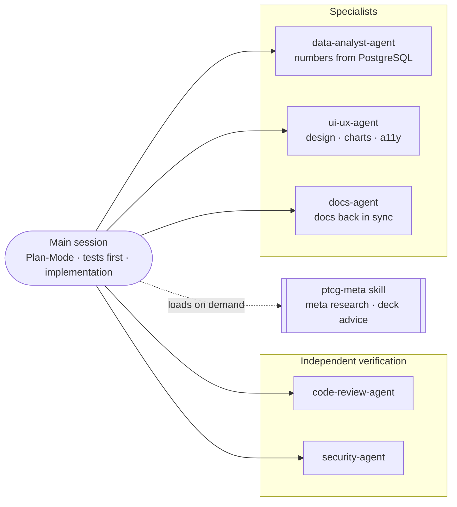

# Claude Agents & Skills

Most work happens in the main Claude Code session: it plans (Plan-Mode), writes tests first and implements. Subagents are used only where a **fresh, independent context** adds value — reviewing a diff without the author's bias, auditing security, or crunching data. Domain knowledge that is needed only sometimes lives in **skills**, which load on demand instead of sitting in every session's context.

Agents are defined in `.claude/agents/` (YAML frontmatter: `name`, `description`, `model`, `memory`), skills in `.claude/skills/`.

> **Why so few?** Until 2026-10 the project had eleven role agents (project head, planner, React implementer, agent auditor, …). Current models plan and implement well on their own and spawn helpers when needed; the role agents mostly added context, cost and contradictions (several still described the old Dexie-only architecture). See the [Anthropic article on context engineering](https://claude.com/blog/the-new-rules-of-context-engineering-for-claude-5-generation-models).

---

## Overview



---

## Agents

### `code-review-agent`
Reviews a finished change with fresh eyes: correctness, user scoping on API routes, React patterns, performance. Read-only, returns findings with severity and `file:line`. **When:** after every non-trivial implementation.

### `security-agent`
Audits authorization and user scoping, input validation (battle logs, deck imports), server-side external calls, secret handling, LLM output validation, XSS, dependencies. **When:** before merging any new user-input processing, API route, external API call, BYOK-key handling or dependency update.

**Key concern:** Battle-log LLM analysis runs **server-side** (`POST /api/analysis/log`, provider-agnostic adapter in `apps/api/src/ai/`). The per-user API key (BYOK) is stored AES-256-GCM-encrypted and decrypted only server-side.

### `data-analyst-agent`
Computes quantitative insights from personal match data and meta snapshots in PostgreSQL — win rates, matchup trends, tier movements, correlations. Delivers numbers, not strategy.

### `ui-ux-agent`
Layout, Tailwind consistency, Recharts configuration, accessibility, responsive design. Ideally produces an HTML mockup or spec before implementation.

### `docs-agent`
Brings `docs/`, READMEs and JSDoc back in sync after structural changes. Typical trigger: the **Docs-Gate** (`.claude/hooks/docs-gate.sh`) blocks `git commit` and names the stale `docs/*.md` files.

---

## Skills

### `ptcg-meta`
Pokémon-TCG domain knowledge: where to research the current meta (Limitless, official rules, ban list), freshness and regional rules (Western format by default, Japanese data only as outlook), verified facts about Limitless API fields, Labs metrics and Bo1/Bo3 formats, and a framework for deck and matchup recommendations. Replaces the former `ptcg-meta-researcher` and `meta-analyst` agents; their accumulated memory moved into `references/`.

---

## Flows

### New feature
```
Main session: Plan-Mode → tests first → implementation → gates green
  → code-review-agent (+ security-agent when input/API/secrets are touched)
  → docs updated (docs-agent if large) → PR
```

### Data / meta feature
```
ptcg-meta skill (research, recommendations) + data-analyst-agent (numbers) → main session implements
```

---

## Agent memory

Agents with `memory: project` keep a persistent directory `.claude/agent-memory/<agent-name>/` (index `MEMORY.md`, one markdown file per memory). It is versioned and shared, so memories stay project-related and free of sensitive data.
