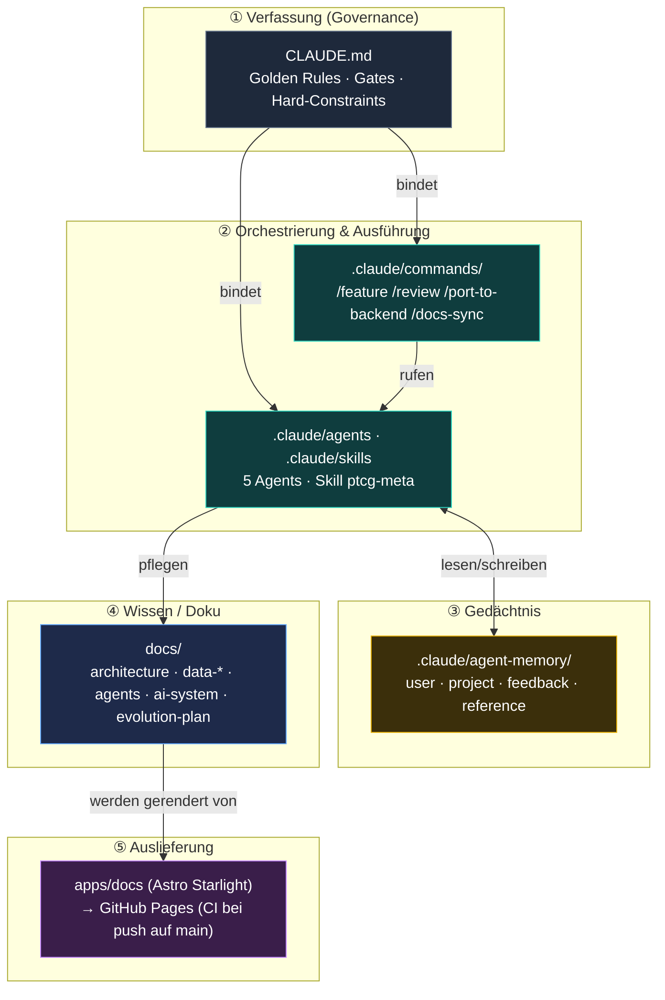
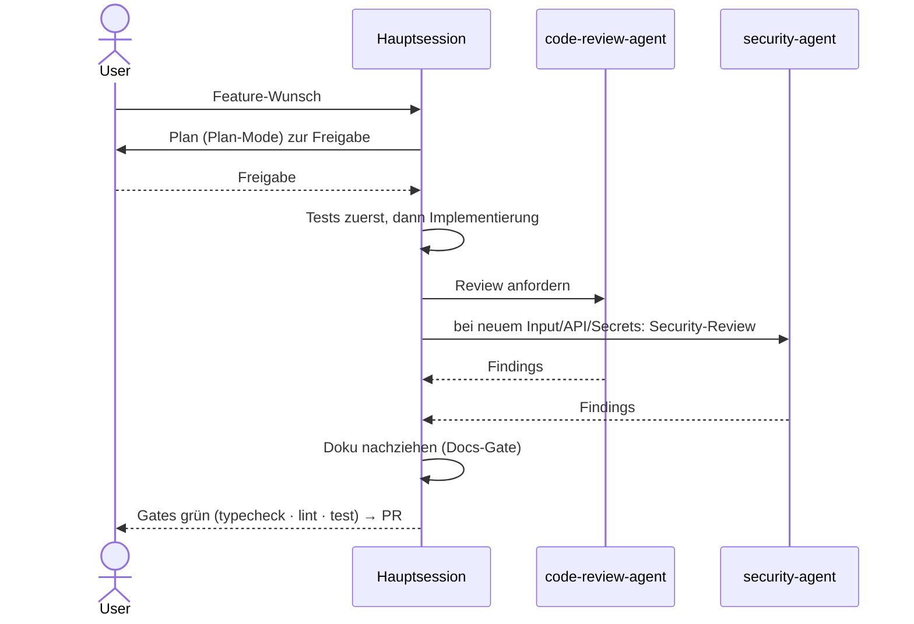
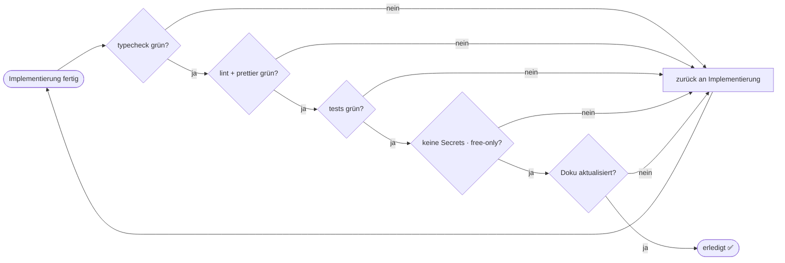
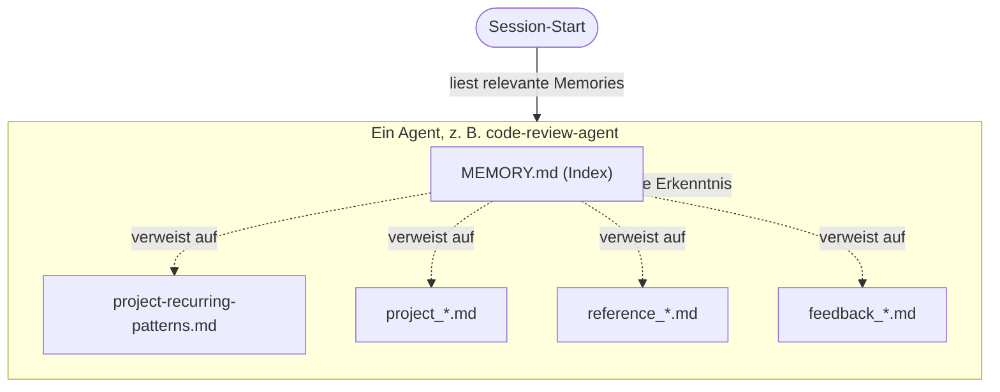
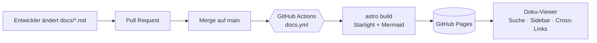
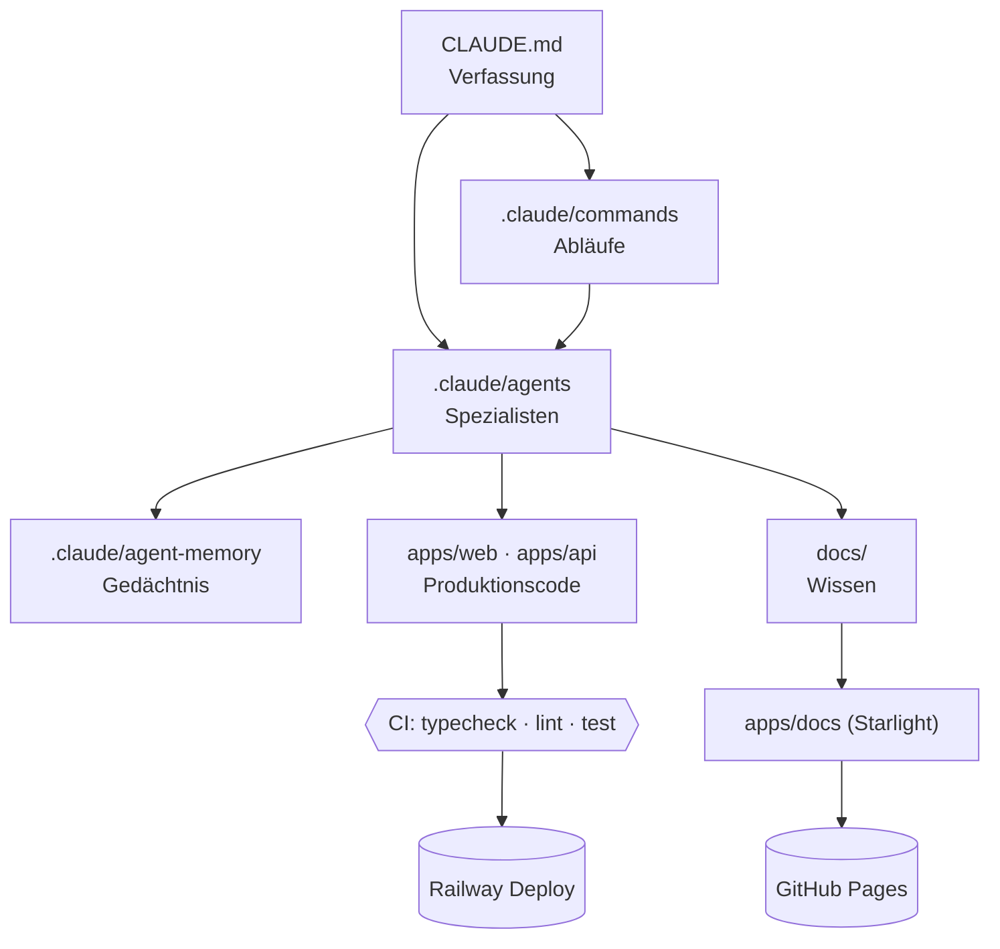

# Das KI-System von Pokekon

> **Was dieses Dokument ist:** Die menschenlesbare Gesamtübersicht über die KI-/Agenten-Umgebung dieses Repositories — wie Leitplanken, Agents, Gedächtnis, Prompt-Bausteine und Dokumentation zusammenspielen. Es ergänzt die maschinen-/assistenten-gerichtete Verfassung [`../CLAUDE.md`](../CLAUDE.md) und die reine Agent-Referenz [`agents.md`](./agents.md).
>
> **Stand:** 2026-06-17 · **Gilt für:** Claude Code, Cowork und jeden Coding-Agent, der im Repo arbeitet.

---

## 1. Idee in einem Satz

Statt einem einzelnen, frei agierenden Assistenten gibt es in `pokekon` ein **mehrschichtiges KI-System**: eine oberste Verfassung (`CLAUDE.md`) legt Grenzen fest, spezialisierte **Agents** erledigen klar abgegrenzte Aufgaben, ein **Memory-System** trägt Wissen über Sessions hinweg, **Commands** kapseln wiederkehrende Abläufe, und die **lebende Dokumentation** macht das Ganze nachvollziehbar.

---

## 2. Schichtenmodell

Die KI-Umgebung besteht aus fünf Schichten. Obere Schichten setzen die Leitplanken, untere führen aus.

| Schicht | Ort | Verantwortung |
|--------|-----|---------------|
| ① Verfassung | [`CLAUDE.md`](../CLAUDE.md) | Nicht verhandelbare Regeln, Workflow, Quality-Gates. Hat Vorrang vor allem darunter. |
| ② Orchestrierung | [`.claude/agents/`](../.claude/agents/), [`.claude/skills/`](../.claude/skills/), [`.claude/commands/`](../.claude/commands/) | Unabhängige Prüfung, Spezialisten, Domänenwissen auf Abruf; wiederverwendbare Abläufe. |
| ③ Gedächtnis | `.claude/agent-memory/` | Persistentes Wissen pro Agent über Sessions hinweg. |
| ④ Wissen | [`docs/`](./) | Architektur, Datenmodell, Roadmap, dieses Dokument. |
| ⑤ Auslieferung | `apps/docs` (geplant) | Starlight-Viewer, automatisch auf GitHub Pages. |

---

## 3. Die Verfassung (`CLAUDE.md`)

Die oberste Schicht. Kernpunkte (vollständig in [`../CLAUDE.md`](../CLAUDE.md)):

- **Erst lesen, dann behaupten** — keine Aussage über Code ohne die Datei gelesen zu haben.
- **Kostenlos bleiben** — keine bezahlten APIs/Dependencies ohne Freigabe.
- **Secrets serverseitig** — API-Keys nie im Browser-Bundle.
- **Eine Quelle der Wahrheit** — keine neue IndexedDB↔API-Doppelung.
- **Tests & Lint grün = fertig** — `typecheck`, `lint`, `test` müssen durchlaufen.
- **Anti-Halluzination** der KI-Analyse bleibt erhalten (Evidence-Quotes, `temperature=0`).
- **Doku folgt dem Code** — strukturändernde Arbeit aktualisiert `docs/`.

Bei Konflikt zwischen einem Agent-File und der Verfassung **gewinnt die Verfassung**, und der Widerspruch wird gemeldet.

### Anti-Halluzinations-Architektur: zwei Analyse-Typen

Das Projekt hat zwei LLM-Analyse-Modi (siehe [`features.md` §8 & §19](./features.md)), die sich in der Art des Groundings unterscheiden:

| Typ | Input | Grounding | Validierung | Use Case |
|-----|-------|-----------|-------------|----------|
| **Battle-Log-Analyse** (§8) | Rohtext aus TCG Live (deutsches Protokoll) | **Wörtliches Zitat:** jede Aussage muss einen verbatim Quote aus dem Rohlog nennen (`evidenceExistsInLog`). | After-parse: Aussagen ohne Beleg werden verworfen (`validateAnalysis`). | Spielzug-Kritik, Fehler identifizieren. |
| **Deck-Synthese** (§19) | Geschlossene Fakten-Liste (Field-Score, Matchups, Card Deltas, Equilibrium) | **Struktur + Richtung:** Aussage muss auf einen Fakt in der Liste zeigen (`factId`), und die Richtung der Aussage muss zum **aus dem Konfidenzband abgeleiteten** Vorzeichen des Fakts passen. | Parallel zu & nach Parsing: Richtung abgeleitet (`deriveFactDirection`), Zahlen sind Platzhalter (Server rendert). | Gesamtdeck-Empfehlungen gegen das Feld. |

Beide nutzen `temperature: 0`, JSON-Struktur und die **geteilte Engine** `@pokekon/shared`; ein **provider-agnostischer Adapter** (`apps/api/src/ai/`) erlaubt Provider-Wechsel ohne Logik-Änderung. Das ist ein Designziel aus CLAUDE.md Golden Rule 6: Anti-Halluzination bleibt, wird nicht aufgeweicht.

---

## 4. Agents & Skills (Schicht ②)

Die Hauptsession plant (Plan-Mode), schreibt Tests zuerst und implementiert. Subagents gibt es nur noch dort, wo ein **frischer, unabhängiger Kontext** etwas bringt; selten gebrauchtes Domänenwissen liegt in einem **Skill**, der erst bei Bedarf geladen wird. Details in [`agents.md`](./agents.md).

| Art | Name | Kurzrolle |
|-----|------|-----------|
| Prüfung | `code-review-agent` | Review des fertigen Diffs (rein lesend) |
| Prüfung | `security-agent` | Input-Processing, Routen, externe Calls, Secrets, Dependencies |
| Spezialist | `data-analyst-agent` | Quantitative Insights aus PostgreSQL (Zahlen, keine Strategie) |
| Spezialist | `ui-ux-agent` | Design, Charts, Accessibility, Mockups |
| Spezialist | `docs-agent` | Doku nach Strukturänderungen nachziehen |
| Skill | `ptcg-meta` | Meta-Recherche, Formate/Quellen, Deck- und Matchup-Empfehlungen |

**Seit 2026-10-18 entfernt:** `tcg-meta-project-head`, `plan-agent`, `react-dev-implementer`, `agent-quality-controller` (Rollen, die die Hauptsession selbst abdeckt; teils noch auf der alten Dexie-Architektur) sowie `ptcg-meta-researcher` und `meta-analyst` (jetzt Skill `ptcg-meta`).

---

## 5. Standard-Flows (wie Arbeit fließt)

Der Standard-Lebenszyklus eines Features — beschrieben in `CLAUDE.md` §3 und im Command [`/feature`](../.claude/commands/feature.md):

Weitere Flows:

- **Daten-/Meta-Feature:** Skill `ptcg-meta` (Recherche, Empfehlungen) + `data-analyst-agent` (Zahlen)
- **Design-Entscheidung:** `ui-ux-agent` (Mockup/Spezifikation) → Hauptsession implementiert
- **Security-Check:** jedes neue Input-Processing → `security-agent` (Pflicht vor Merge)

---

## 6. Quality-Gates (das Tor zu „fertig")

Kein Stück Arbeit gilt als erledigt, bevor diese Tore offen sind:

Technisch abgesichert durch husky + lint-staged (Prettier pre-commit) und `.github/workflows/ci.yml`.

### Das Docs-Freshness-Gate

Ein zusätzliches Gate (`.claude/hooks/docs-gate.sh`) läuft lokal als Claude-Code-Hook: Es **erkennt strukturändernde Dateien** (z. B. neue Routes, geänderte Datenbank-Schemas, neue Komponenten) und **blockiert `git commit`** innerhalb einer laufenden Session, solange die betroffenen Doku-Dateien nicht aktualisiert wurden. Die zugehörige Testsuite (`.claude/hooks/docs-gate.test.sh`, eingehängt als `npm run test:hooks`) läuft zusätzlich automatisiert in CI (`.github/workflows/ci.yml` → `npm run test`) — das prüft die Hook-**Logik**, nicht das Blockieren selbst, denn CI führt keinen `git commit` aus. Die Zuordnung „Pfad → betroffene `docs/*.md`" ist differenziert — z. B. `apps/api/src/routes/meta.ts` → `docs/features.md` (Abschnitt „Live Meta Sync").

**Warum:** Golden Rule 7 verlangt „Doku folgt dem Code", aber es gab bisher keine technische Durchsetzung. Ein Agent oder ein Mensch konnte Code ändern und vergessen, die Doku zu aktualisieren — jetzt wird das vom Hook erkannt.

**Übersteuern:** Falls die Heuristik falschpositiviert (z. B. ein interner Refactor ohne fachliche Änderung), nennt der Block-Text beim nächsten `git commit`-Versuch den aufgelösten Pfad zum Dirty-Marker — `rm <pfad>` hebt den Block auf, identisch zu `rm .git/claude-tdd-dirty`.

**Wichtig:** Das Gate **schreibt niemals Doku-Inhalte** — es signalisiert nur „hier könnte Doku veraltet sein." Das Aktualisieren bleibt ein bewusster, vom Agenten oder Menschen durchgeführter Schritt. Der `docs-agent` wird typischerweise von diesem Gate ausgelöst.

---

## 7. Gedächtnis-System (Schicht ③)

Jeder Agent hat ein persistentes Verzeichnis `.claude/agent-memory/<agent-name>/`. Memories sind einzelne Markdown-Dateien mit YAML-Frontmatter; `MEMORY.md` je Agent ist der Index.

Vier Memory-Typen: **user** (Rolle/Präferenzen), **project** (laufende Arbeit/Entscheidungen), **feedback** (Korrekturen & bestätigte Ansätze, mit *Warum*), **reference** (Zeiger auf externe Ressourcen). Memories sind versioniert und werden mit dem Team geteilt — daher projektbezogen formulieren, keine sensiblen Daten.

---

## 8. Auslieferung: lebende Dokumentation (Schicht ⑤)

Die Doku unter [`docs/`](./) ist die Quelle der Wahrheit. Sie wird (geplant) als **Astro Starlight** in `apps/docs` gerendert und bei jedem Push auf `main` automatisch und **kostenlos** auf GitHub Pages deployt.

Warum Starlight: automatische Sidebar/Hierarchie aus der Ordnerstruktur, Volltextsuche, native Cross-Links zwischen `.md`-Dateien und Mermaid-Rendering — genau das gewünschte „Verzeichnis aus gut verlinkten, hierarchischen `.md`-Files". Details und Umsetzung in [`backend-evolution-plan.md`](./backend-evolution-plan.md) Abschnitt 8 und im Implementierungs-Prompt unter [`prompts/`](./prompts/).

---

## 9. Wie alles zusammenhängt (Gesamtbild)

---

## 10. Bekannte Drift / Pflege-Hinweise

- **`architecture.md` — Drift behoben (2026-08):** Die frühere „zero-backend SPA"-Beschreibung ist korrigiert; die Datei beschreibt jetzt die reale Hono+Postgres-Architektur mit serverseitiger, provider-agnostischer LLM-Analyse (siehe [`backend-evolution-plan.md`](./backend-evolution-plan.md) Abschnitt 1).
- **Agent-Definitionen vs. Realität — behoben (2026-10-18):** Die Dexie-zentrierten Rollen-Agents sind entfernt; die verbliebenen fünf Agents beschreiben die Hono+Postgres-Realität.
- **Pflege:** Bei neuen Agents/Skills/Commands dieses Dokument und [`agents.md`](./agents.md) mitführen (`/docs-sync`). Neues Wissen lieber als Skill (lädt bei Bedarf) als als neuen Agent.

---

## Verweise

- [`../CLAUDE.md`](../CLAUDE.md) — Verfassung / Hard-Rules
- [`agents.md`](./agents.md) — Agents, Skills & Flows
- [`backend-evolution-plan.md`](./backend-evolution-plan.md) — Roadmap inkl. Battle-Log-Zugqualität & Doku-Viewer
- [`architecture.md`](./architecture.md) — App-Architektur
- [`../.claude/commands/`](../.claude/commands/) — Prompt-Bausteine
